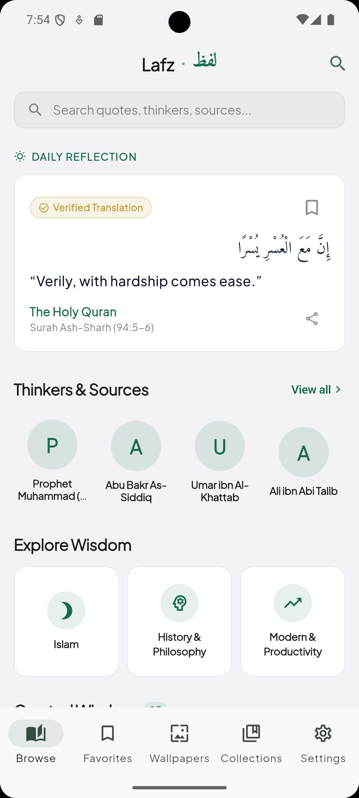
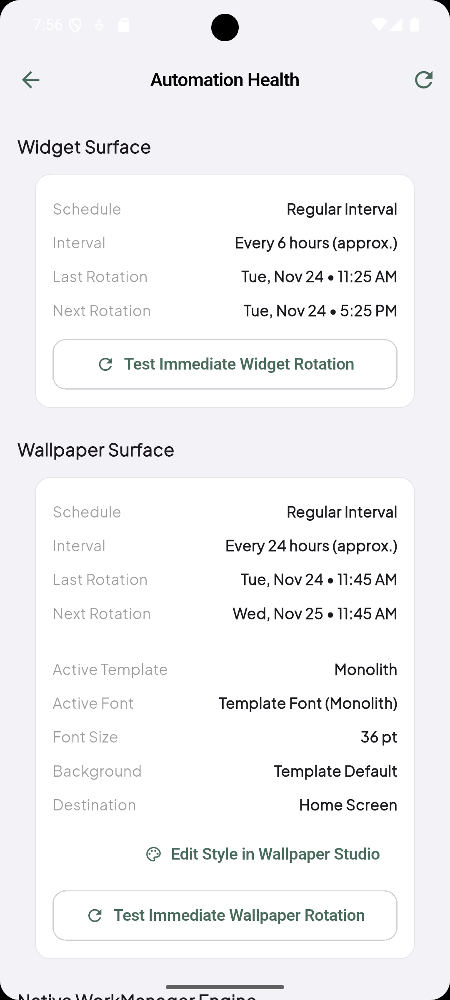
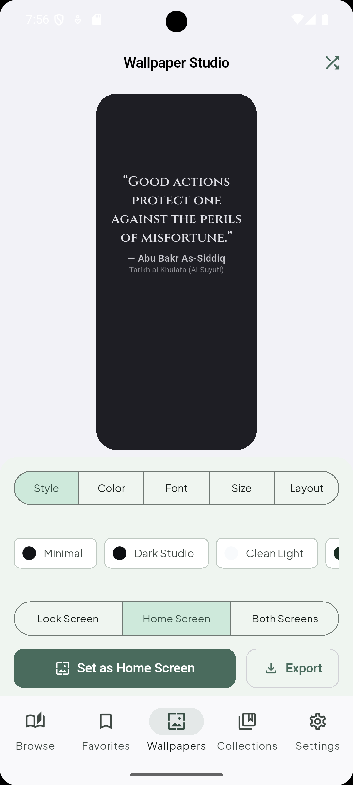
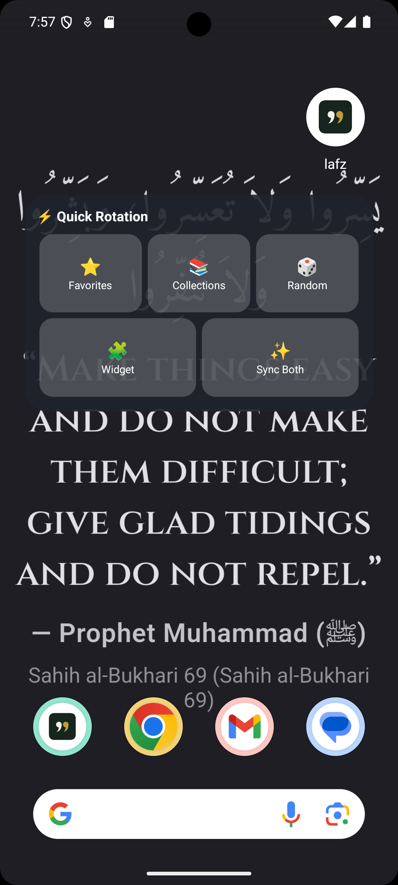
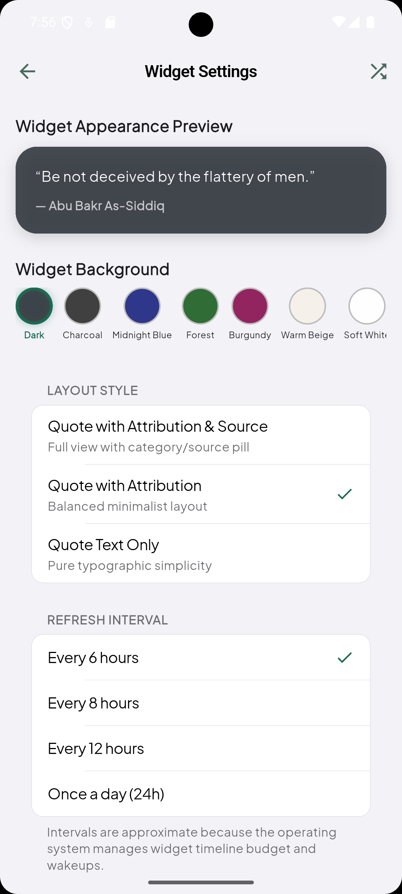

# Lafz (لفظ)

> **"Your chosen wisdom, beautifully delivered."**

[](https://flutter.dev)
[](https://dart.dev)
[](#architecture--technology-stack)
[](#getting-started--setup-guide)
[](#license)

**Lafz** (Arabic: لفظ, meaning *word* or *articulated speech*) is an ambient, local-first mobile companion designed to turn your curated wisdom, principles, and scripture into persistent visual reminders across your daily digital environments — without requiring you to spend hours inside an app.

Instead of feeds, algorithms, or intrusive notifications, Lafz brings meaning directly to your **Home Screen Widgets**, **Lock Screen Wallpapers**, and **Home Screen Wallpapers** through deterministic background rotation, native Android widgets, and typographic craftsmanship.

---

## 🎬 Demo & Screenshots

### Screenshots Gallery

| **1. Home Screen** | **2. Automation & Health** | **3. Wallpaper Studio** |
|:---:|:---:|:---:|
|  |  |  |
| *Daily quote feed & bilingual header* | *Background schedules & Doze status* | *8 presets, typography & safe zones* |

| **4. Basic Timeline Widget** | **5. Quick Rotation Hub** | **6. Basic Widget Customization** |
|:---:|:---:|:---:|
|  |  |  |
| *Ambient home-screen quote tile* | *5-tile native control remote* | *Live palette, font & layout controls* |

<p align="center">
  <strong>7. Live Home Wallpaper</strong><br>
  <br>
  <em>Rendered wallpaper with icon grid</em>
</p>

---

## 🌟 Key Highlights & Vision

- **Local-First & Offline**: Operates 100% offline with zero network dependency. All baseline content (200+ verified quotes across Quran, Hadith, Classical Philosophy, and Modern Focus) is pre-bundled in SQLite.
- **Privacy by Design**: No accounts required, no telemetry tracking your reading habits, no analytics intercepting your favorite quotes.
- **Ambient Delivery**: The app is designed for minimal active screen time. Configure your collections, customize your aesthetics, and let the system gracefully deliver wisdom in the background.
- **Bilingual & RTL Craftsmanship**: Built-in native support for English, Arabic, and Urdu with appropriate font pairings (Amiri, Plus Jakarta Sans, Playfair Display, Cinzel, Lora), correct tashkeel/diacritics rendering, and proper RTL layouts.
- **Deterministic Shuffle-Bag Rotation**: Avoids repetitive wallpaper loops. Employs a mathematical shuffle-bag algorithm with non-repeating cycles and automatic bag replenishment.
- **Dual Native Android Widgets**:
  1. **Ambient Quote Widget**: Live previewable home screen widget with customizable background palettes, attributions, and source badges.
  2. **Quick Rotation Hub**: A 5-tile native control pad for instant home screen wallpaper rotation, widget shuffling, and library discovery via custom deep links (`lafz://lafz.app/hub/...`).

---

## 📱 Features

### 1. Curated Wisdom Taxonomy
Explore an authentic, hierarchical taxonomy covering:
- **Islam**: The Noble Quran (Surah/Ayah citations), Prophetic Hadith (collection references & gradings), Companions (Sahaba), and Classical Scholars (Al-Ghazali, Ibn Qayyim, etc.).
- **History & Philosophy**: Stoicism (Marcus Aurelius, Seneca, Epictetus), Classical Greek Thinkers (Socrates, Plato, Aristotle), and Eastern Philosophy.
- **Modern & Productivity**: Focus, deliberate practice, leadership, and mindset principles.
- **Attribution & Verification**: Strict distinction between verified quotes, identified sources, and original translations.

### 2. Typographic Wallpaper Studio & Engine
- **8 Tailored Presets**:
  - `Minimal` (Playfair Display)
  - `Nature` (Lora)
  - `Architecture` & `Editorial` (Cinzel)
  - `Dark`, `Light`, `Abstract`, and `Clean` (Plus Jakarta Sans)
- **Safe Area Preservation**: Automatically calculates OS status bar, lock-screen clock zones (top 22%), and navigation gesture/dock bars (bottom 14%–18%) to ensure text is never obscured.
- **WCAG 2.1 AA Adaptive Contrast Engine**: Dynamically calculates background luminance and applies subtle scrim overlays if text contrast ratio drops below 4.5:1.
- **Simulated Preview Mode**: Preview final compositions with toggleable mock lock-screen clock and home-screen icon grid overlays.

### 3. Native Background Automation
- **Android WorkManager Engine (`LafzRotationWorker`)**: Executes reliable, battery-efficient background rotations on independent schedules (every 6h, 8h, 12h, 24h, or custom routines).
- **Automation Health Dashboard**: In-app diagnostics checking battery optimization exemption status (Doze mode) to prevent aggressive OEM background killing.
- **WallpaperManager Bridge**: Direct native bridge applying rendered high-resolution wallpapers to Lock Screen, Home Screen, or Both.

### 4. Interactive Home-Screen Widgets
- **Lafz Timeline Widget (`LafzWidgetProvider`)**: Multi-layout support (Quote only, Quote + Attribution, Quote + Collection Pill) with 10 custom color themes (Charcoal, Midnight Blue, Forest, Burgundy, Warm Beige, Cream, Slate, Teal, etc.).
- **Quick Rotation Hub (`LafzHubWidgetProvider`)**:
  - ⭐ **Favorites**: Rotates wallpaper exclusively from your bookmarked favorites.
  - 📚 **Collections**: Shuffles wisdom from active followed collections.
  - 🎲 **Random**: Picks from the entire published wisdom library.
  - 🧩 **Widget**: Instantly advances your home-screen widget to the next quote.
  - ✨ **Sync Both**: Synchronously updates both widget timeline and device wallpaper.

---

## 🏗️ Architecture & Technology Stack

Lafz follows a modular, feature-first architecture that cleanly separates pure domain logic from Flutter presentation and platform-specific native layers:

```text
┌─────────────────────────────────────────────────────────────┐
│                       FLUTTER APP                           │
│  ┌─────────────────┐ ┌─────────────────┐ ┌───────────────┐  │
│  │  Presentation   │ │   Application   │ │  Data Layer   │  │
│  │ (GoRouter, UI)  │ │ (Riverpod State)│ │ (Repositories)│  │
│  └────────┬────────┘ └────────┬────────┘ └───────┬───────┘  │
└───────────┼───────────────────┼──────────────────┼──────────┘
            │                   │                  │
            ▼                   ▼                  ▼
┌─────────────────────────────────────────────────────────────┐
│                    CORE UTILS & DATABASE                    │
│  • RotationEngine (Deterministic Shuffle-Bag)               │
│  • ContrastChecker (WCAG 2.1 AA Relative Luminance)         │
│  • SQLite Database (lafz.db via sqflite / sqflite_ffi)      │
│  • Seeded from assets/content/baseline_content.json         │
└───────────────────────────────┬─────────────────────────────┘
                                │ MethodChannels
                                ▼
┌─────────────────────────────────────────────────────────────┐
│                   NATIVE ANDROID MODULES                    │
│  • MainActivity.kt (WallpaperManager Bridge & Channels)     │
│  • LafzRotationWorker.kt (WorkManager Periodic Worker)      │
│  • LafzWidgetProvider.kt (Quote AppWidget RemoteViews)      │
│  • LafzHubWidgetProvider.kt (5-Tile Deep Link Remote)       │
└─────────────────────────────────────────────────────────────┘
```

### Tech Stack Details

| Component | Technology | Role |
| :--- | :--- | :--- |
| **Framework** | [Flutter 3.x](https://flutter.dev) / Dart 3.x | Cross-platform UI & graphics rendering |
| **State Management** | [flutter_riverpod 2.6+](https://riverpod.dev) | Reactive, testable dependency injection |
| **Navigation** | [go_router 14.8+](https://pub.dev/packages/go_router) | Declarative routing & custom deep link handling |
| **Local Storage** | [sqflite](https://pub.dev/packages/sqflite) & `sqflite_common_ffi` | Offline SQLite database engine |
| **Typography** | [google_fonts](https://pub.dev/packages/google_fonts) | Amiri, Plus Jakarta Sans, Playfair, Lora, Cinzel |
| **Background Tasks** | `androidx.work:work-runtime-ktx` | Android WorkManager periodic wallpaper engine |
| **Widgets** | Android RemoteViews & AppWidgetProvider | Native home-screen widget implementations |

---

## 📂 Project Directory Structure

```plaintext
Lafz/
├── android/                             # Native Android project
│   └── app/src/main/
│       ├── AndroidManifest.xml          # Permissions, receivers & deep-link filters
│       ├── kotlin/com/lafz/lafz/
│       │   ├── MainActivity.kt          # Wallpaper & Widget MethodChannels
│       │   ├── LafzRotationWorker.kt    # WorkManager headless background rotation
│       │   ├── LafzWidgetProvider.kt    # Native Timeline AppWidget
│       │   └── LafzHubWidgetProvider.kt # 5-Tile Quick Rotation Hub AppWidget
│       └── res/
│           ├── layout/                  # RemoteViews XML (hub_widget, widget_layout)
│           ├── drawable/                # Widget shape drawables & backgrounds
│           └── xml/                     # AppWidget provider info XMLs
├── assets/
│   ├── content/
│   │   └── baseline_content.json        # Curated 200+ quotes, categories & authors
│   └── images/                          # Curated background images
├── lib/
│   ├── app/                             # Top-level application, router & themes
│   │   ├── app.dart                     # MaterialApp.router configuration
│   │   ├── router.dart                  # GoRouter declarative route definitions
│   │   └── theme.dart                   # Light & dark theme palettes
│   ├── core/                            # Shared core primitives & utilities
│   │   ├── constants/app_constants.dart # Dimension percentages, defaults & names
│   │   ├── enums/enums.dart             # Statuses, tiers, schedule types, presets
│   │   ├── models/                      # Immutable Dart data models
│   │   ├── providers/providers.dart     # Riverpod global dependency providers
│   │   ├── utils/contrast_checker.dart  # WCAG luminance and overlay calculator
│   │   └── utils/rotation_engine.dart   # Deterministic shuffle-bag rotation engine
│   ├── data/                            # Local database & repository interfaces
│   │   ├── database/database_helper.dart# SQLite lifecycle, schema & seed loader
│   │   └── repositories/                # Quotes, Collections, Favorites, Settings
│   ├── features/                        # Feature-first screens and widgets
│   │   ├── collections/                 # Followed & personal collections
│   │   ├── favorites/                   # User bookmarked favorites
│   │   ├── hub/                         # Deep-link action executor (HubActions)
│   │   ├── library/                     # Browse, Categories, Authors, Quote cards
│   │   ├── onboarding/                  # Multi-step 90s intro wizard
│   │   ├── quote_detail/                # Detail view, source context, full text
│   │   ├── settings/                    # Automation health, widget preferences
│   │   └── wallpapers/                  # Studio, Renderer widget, presets
│   ├── native/
│   │   └── native_bridge.dart           # Platform channel bridge to Kotlin
│   └── main.dart                        # Application bootstrap & entry point
├── test/                                # Unit, repository, and widget tests
│   ├── contrast_checker_test.dart       # WCAG formula validation tests
│   ├── database_repository_test.dart    # SQLite CRUD & Favorites integration tests
│   ├── rotation_engine_test.dart        # Shuffle-bag deterministic rotation tests
│   └── widget_test.dart                 # QuoteCard and UI widget tests
├── pubspec.yaml                         # Project dependencies and asset manifests
└── README.md                            # Comprehensive project documentation
```

---

## 🚀 Getting Started & Setup Guide

### Prerequisites
- [Flutter SDK](https://docs.flutter.dev/get-started/install) (`^3.11.4` or later)
- [Android Studio](https://developer.android.com/studio) with Android SDK (API 34+ recommended, minimum API 24)
- Java 17 Development Kit (JDK 17)

### 1. Clone & Fetch Dependencies
```bash
git clone https://github.com/your-username/lafz.git
cd lafz
flutter pub get
```

### 2. Verify Code Quality & Run Tests
```bash
# Run static analysis
flutter analyze

# Execute all automated test suites
flutter test
```

### 3. Run on Android Device / Emulator
```bash
# Launch on connected device
flutter run
```

> **Note on Native Widgets**: When testing newly added or modified Android AppWidgets (`hub_widget.xml` or `LafzHubWidgetProvider.kt`), always perform a full rebuild (`flutter run` or `flutter build apk`) rather than a Hot Reload / Hot Restart so Android packages the new resource manifests.

---

## 📲 Setting Up Home Screen Widgets on Android

1. Long-press an empty space on your Android Home Screen.
2. Select **Widgets** from the launcher menu.
3. Scroll to **Lafz**.
4. Choose between:
   - **Lafz Daily Quote**: Drag to home screen. Customize background palette and font layout directly inside the in-app *Settings > Widget Settings*.
   - **Quick Rotation Hub**: Drag the 5-tile control pad to your home screen for one-tap wisdom rotation on the fly.

---

## 🧪 Testing Matrix

Lafz includes a comprehensive test suite to guarantee reliability across rotation algorithms, database operations, and WCAG accessibility standards:

- **`rotation_engine_test.dart`**: Verifies deterministic shuffle-bag refilling, exclusion of the currently displayed quote, handling of empty bags, and collection/favorites merging.
- **`contrast_checker_test.dart`**: Verifies relative luminance calculations for edge colors (black, white, grays) and confirms scrim overlay calculation meets the 4.5:1 ratio.
- **`database_repository_test.dart`**: Validates in-memory SQLite table creation, quote insertion, verification status queries, and soft-delete/toggling of user favorites.
- **`widget_test.dart`**: Verifies UI component rendering, verification status tags, and attribution formatting.

---

## 🔒 Privacy Philosophy

Lafz firmly believes that personal reflections, beliefs, and philosophies belong exclusively to the individual.
- **No Analytics on Quotes**: The app does not send data about what quotes you read, star, or display.
- **No Cloud Tracking**: All collections, rotation history, and wallpaper preferences reside in your local SQLite database on your device.
- **Zero Third-Party Ad SDKs**: No trackers, ad networks, or data brokers are integrated.

---

## 📄 License

Copyright © 2026 Lafz. All rights reserved.  
Distributed under proprietary license. Built with care for lovers of wisdom, reflection, and quiet craft.
